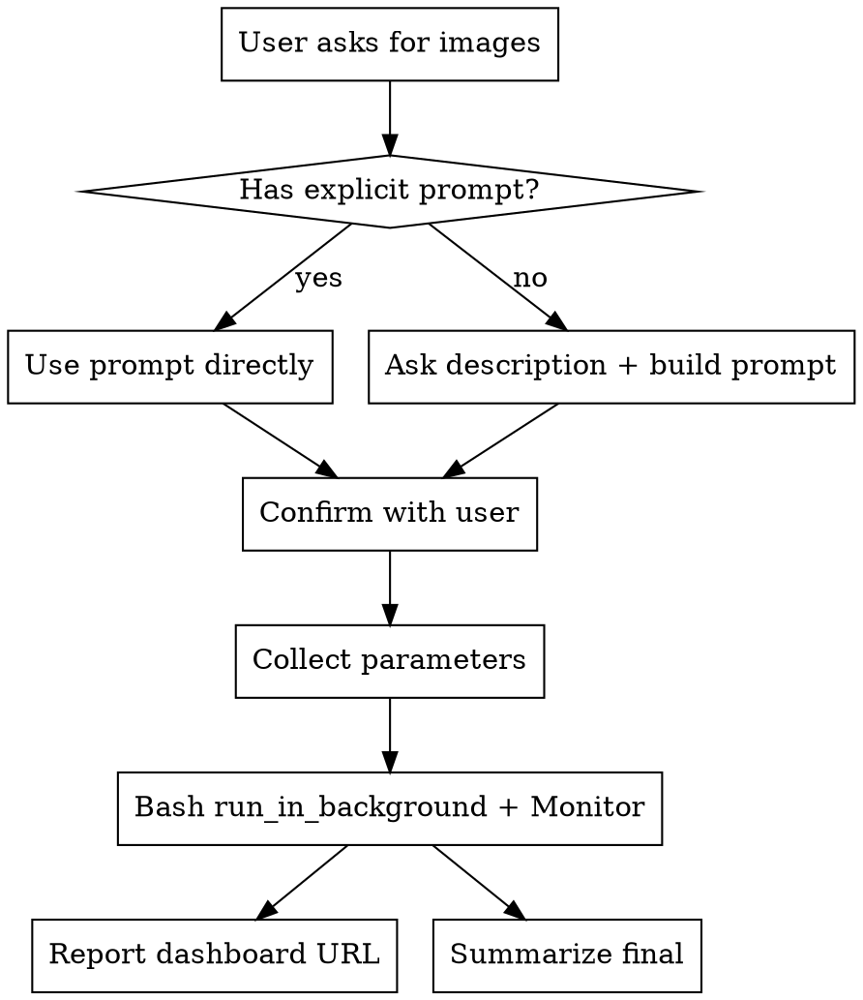

# Bulk Image Generation

## Overview

Orchestrate bulk image generation via Pollinations.ai (free public API, no key required). A Python helper does the actual requests, saves images to disk, and writes a self-refreshing HTML dashboard the user can open in their browser. Claude gathers the prompt, then monitors the generation live via the `Monitor` tool.

## When to Use

- User asks to generate more than ~3 images at once.
- Seeding demo assets for a project (avatars, product photos, lesions, datasets).
- User mentions Pollinations, bulk generation, or shows the existing `bulk-image-generator.html` tool.

**Don't use** for single image generation (too much overhead), for images requiring paid models (DALL-E 3, Midjourney — this helper only uses Pollinations), or for anything the provider's content policy would reject (nudity, gore, real people, medical imagery beyond benign skin texture).

## Workflow



## Step 1 — Prompt intake

Two paths, always offer both:

1. **User already pasted a prompt**: show it back, ask if they want it used as-is OR refined.
2. **User only described intent**: write a professional prompt yourself. A professional image prompt for Pollinations has this shape:
   - Subject + attributes (age range, ethnicity if relevant, clothing, expression)
   - Style qualifier (photorealistic, studio lighting, macro, product shot, etc.)
   - Background (plain neutral, pure white, etc.)
   - Constraints (no text, no watermark, no props)
   - Composition (head-and-shoulders, full body, centered, 1:1 aspect)
   - Variation hint (different ages, ethnicities, lighting angles — tells the model to not repeat the same face)

Show the generated prompt and ask for approval before spending time/API calls.

## Step 2 — Parameters

Ask the user (or use defaults when obviously implied):

| Param | Default | Notes |
|---|---|---|
| count | 10 | Clamped 1-50 |
| model | flux | Alternatives: turbo (faster), gptimage (DALL-E style), seedream |
| width, height | 768 | 512 / 768 / 1024 recommended |
| output dir | ask | Absolute path; subfolder per category (e.g. `storage/app/demo/avatars/male`) |
| delay | 5 | Seconds between images to avoid rate limit |
| enhance | false | Let the server rewrite the prompt (quality up, control down) |
| seed | random | Pass an int to reproduce a run |

## Step 2.5 — API key decision (BEFORE launching generation)

Always ask the user **before** launching a run:

> ¿Usar la API pública de Pollinations (free, rate-limit compartido) o tu propia key (más capacidad, cola prioritaria)?

Then:

1. **Public API** → launch the generate command WITHOUT `--auth`. Done.
2. **User's key**:
   - Run `python generate.py --show-config` to check if a token is already saved. The script emits a `config` event with `has_token: true|false`.
   - **Token already saved** → ask the user "¿Usamos la saved or quieres poner una nueva?" and either use `--auth` directly or run `--set-token` first.
   - **No token saved** → run `python generate.py --set-token` as a **background task** via `Bash(run_in_background=true)`. The script will emit `token-server-ready` with a local URL like `http://127.0.0.1:54321/`. Show that URL to the user and ask them to open it, paste their token, and click Save. Use `Monitor` on the background task to wait for the `token-saved` event, then proceed.
3. Once a token is present, launch generation with `--auth` added to the normal args.

Do NOT ask Claude to paste tokens directly in chat — the web form is the only way to get the token into `~/.bulk-image-generation/config.json` without leaking it into the conversation history.

## Step 3 — Launch

Use `Bash` with `run_in_background: true`:

```bash
python ~/.claude/skills/bulk-image-generation/generate.py \
  --prompt "THE PROMPT" \
  --count 10 \
  --model flux \
  --width 768 --height 768 \
  --output "/absolute/path/to/output" \
  --delay 5 \
  [--auth]   # only if the user opted in to their own key
```

The script emits JSON-line events to stdout, one per fetch/poll/done/error. It writes a live `dashboard.html` in the output directory that auto-refreshes every 2 seconds while running.

Immediately after launching, tell the user:

> Dashboard: `file:///absolute/path/to/output/dashboard.html`

They open that in their browser to see the grid fill up live.

## Step 4 — Monitor

Start a `Monitor` task that tails the background process and forwards noteworthy events. Target filter: `done|failed|rate-limited|complete`. Let the user see progress in the dashboard; Claude Code sees structured events via Monitor.

Do NOT poll with repeated `tail` commands. The Monitor tool is the intended channel.

## Step 5 — Final report

When the `complete` event arrives (or Monitor stream ends), summarize:
- Total done / failed
- Elapsed time
- Output directory + dashboard URL
- If failures exist, offer to retry only the failed seeds (re-run the script with `--seed <failed_seed>` and `--count 1` per failure, or let user re-run manually).

Every run writes `run.json` next to `dashboard.html` with the full parameters + per-seed status. That file is the source of truth for recovery.

## Recovery mode

Pollinations caches every generated image by the full URL hash: `prompt + model + seed + width + height`. Requesting the same URL again returns the cached bytes in ~1 second without burning a generation slot. Two ways to exploit this:

**A. User remembers the seed base** — the simplest case. They generated 20 images with base seed `12345` in the old HTML tool or a previous script run. They tell you the seed, you pull the same images:

```bash
python ~/.claude/skills/bulk-image-generation/generate.py \
  --recover \
  --prompt "THE ORIGINAL PROMPT" \
  --seed 12345 \
  --count 20 \
  --model flux \
  --width 768 --height 768 \
  --output "/absolute/output/dir"
```

**B. Previous run wrote `run.json`** — point `--from` at it and everything fills in:

```bash
python ~/.claude/skills/bulk-image-generation/generate.py \
  --from /path/to/previous/run.json \
  --output /new/output/dir
```

The prompt, model, dimensions, seed base and count are loaded from the JSON. `--from` implies `--recover`.

In recovery mode the script overrides timeouts/delays internally:
- `fetch_timeout = 15s` (cache hits return fast; anything slower is a miss)
- `poll_wait = 0`, `max_polls = 0` (don't wait on the server to re-generate)
- `delay = 2s` between requests (just enough to dodge rate limits)

Missing-from-cache images emit `failed` events with a short error, which you can re-request in normal mode with the same seed(s) if you actually want them regenerated.

## Anti-patterns

- **Running without stdout capture**: lose the event stream. Always use `run_in_background: true` so the Monitor tool can read the task output.
- **Huge batches without staging**: >50 images per run. The script caps at 50; for more, run it multiple times with different `--seed` bases.
- **Forgetting the dashboard URL**: the user doesn't see progress without it. Always print the `file://` URL right after launch.
- **Generating forbidden content**: do not prompt for NSFW, real named people, explicit medical imagery. Pollinations will either refuse or produce garbage.
- **Assuming the prompt is fine**: always show the user the final prompt and get explicit approval before launch. One bad run wastes minutes and API quota.

## Supporting file

`generate.py` — the stdlib-only Python helper. See the script for CLI reference. Reads no env vars. No network dependencies other than Pollinations.
